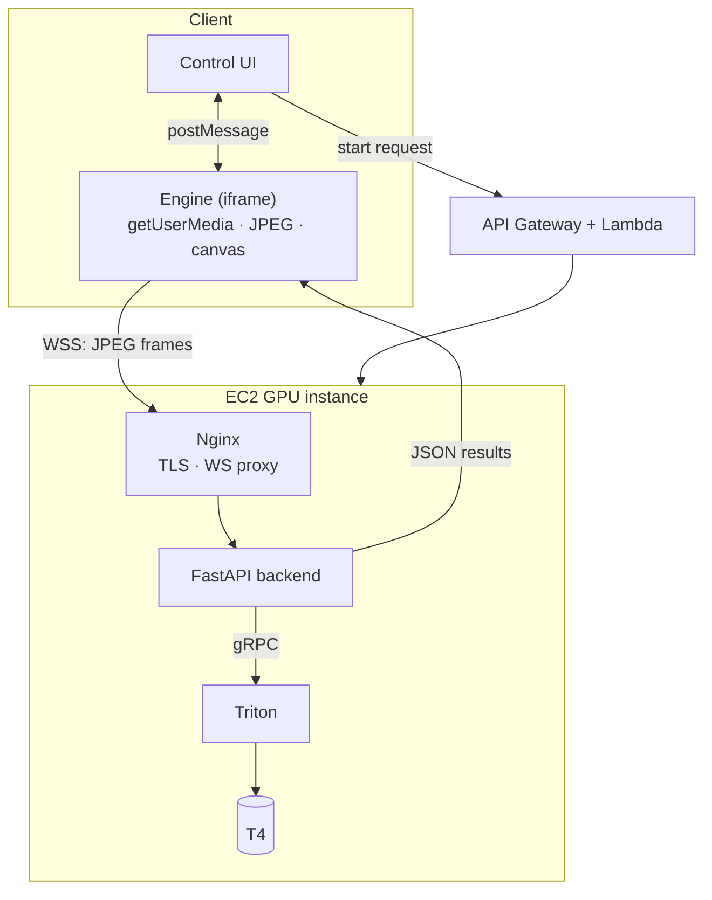
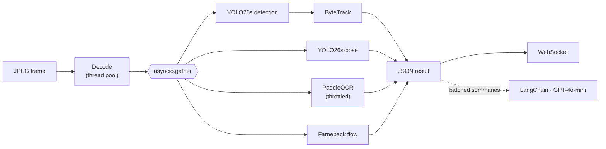
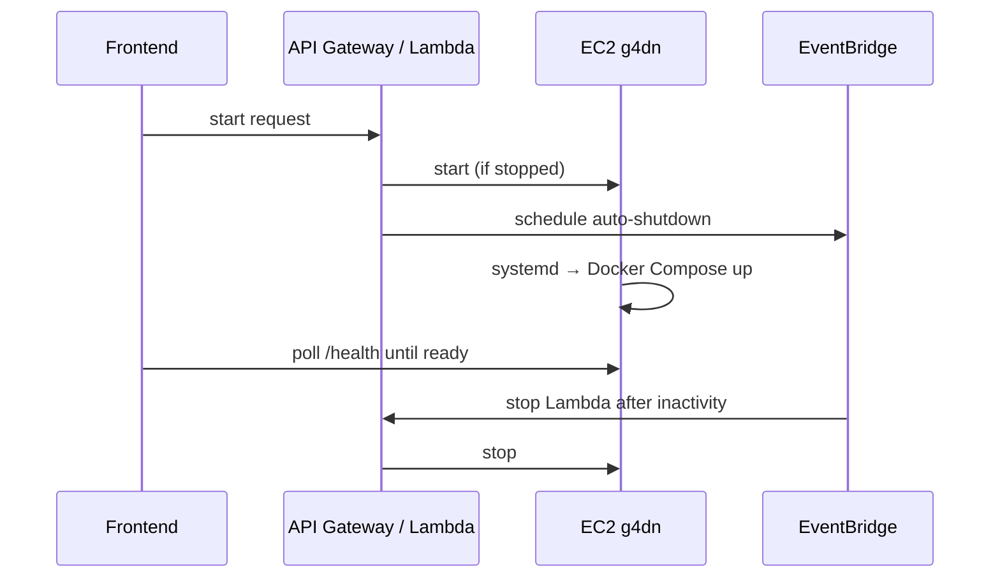

# Architecture

Low-latency GPU inference delivered to a web browser. The browser keeps a stable frame rate regardless of backend inference speed.

## Contents

- [Overview](#overview)
- [Data flow](#data-flow)
- [Components](#components)
- [Backend](#backend)
- [Inference pipeline](#inference-pipeline)
- [Triton](#triton)
- [Backpressure](#backpressure)
- [On-demand GPU lifecycle](#on-demand-gpu-lifecycle)
- [Monitoring](#monitoring)

---

## Overview

Four layers:

1. **Browser client** — control UI and engine runtime
2. **AWS orchestration** — start/stop of the GPU instance
3. **GPU host (EC2)** — Nginx, Docker Compose
4. **Inference runtime** — FastAPI backend and Triton

Principle: **frontend FPS is decoupled from inference FPS.** The backend may run at 5–20 FPS depending on GPU load while the browser renders at 30 FPS or more and interpolates between results.

---

## Data flow

Results travel back as GPU → Triton → FastAPI → WebSocket → engine → canvas overlay.

---

## Components

### Control UI

Session start, model selection, status display, stop. It does not transmit video frames.

### Engine

Runs in an iframe and communicates with the UI through `window.postMessage`.

- camera capture with `getUserMedia`
- frames resized to 320×240 and JPEG-encoded
- WebSocket transport
- overlay rendering at 30–60 FPS, interpolating between backend results

The iframe provides an independent lifecycle, crash isolation and a restartable runtime.

### Nginx

Runs on the host, outside Docker. Terminates TLS, proxies the WebSocket endpoint `wss://api.<domain>/ws/inference` and exposes `/health`. Reference configs are in [`nginx/`](nginx/).

---

## Backend

Asynchronous WebSocket server built with FastAPI.

- receives binary JPEG frames
- JPEG decoding in a thread pool, off the event loop
- per-session frame queue
- concurrent inference sessions limited by an `asyncio.Semaphore`
- result streaming, heartbeat ping every 5 s
- no video is stored or rendered on the server

---

## Inference pipeline

Modules are enabled per session through the `init` message.

---

## Triton

All TensorRT models are served by Triton over async gRPC. Model configs live in [`triton/model_repository/`](triton/model_repository/):

| Model | Platform | Max batch | Input | Output |
|---|---|---|---|---|
| `yolo` | `tensorrt_plan` | 1 | FP16 `[3, 640, 640]` | FP32 `[300, 6]` |
| `yolo_pose` | `tensorrt_plan` | 1 | FP16 `[3, 640, 640]` | FP32 `[300, 57]` |

GPU contention is bounded by limiting the number of concurrently running inference sessions.

---

## Backpressure

Each session owns a frame queue of size 2. When a new frame arrives and the queue is full, the oldest frame is discarded.

- latency stays bounded by the model, not by the sender
- memory use is constant
- the UI always shows the most recent result

The system is tuned for low latency rather than maximum throughput.

---

## On-demand GPU lifecycle

Boot chain: EC2 boot → systemd → Docker Compose → Triton → Backend → Prometheus.

---

## Monitoring

Prometheus scrapes the backend and Triton.

| Source | Examples |
|---|---|
| Backend | `inference_active_sessions`, `inference_duration_seconds`, `gpu_semaphore_in_use`, `pipeline_fps`, `session_frames_total` |
| Triton | inference counts, queue and compute durations (port 8002) |
