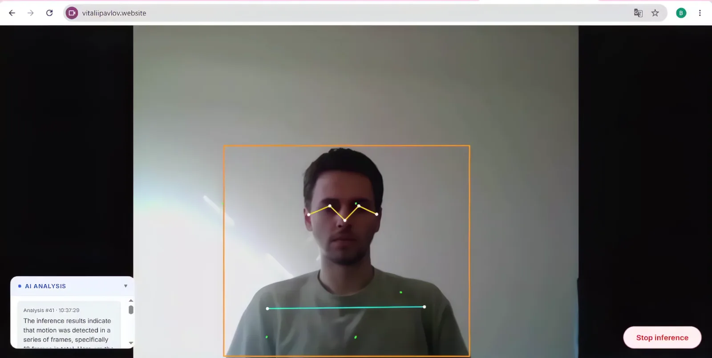
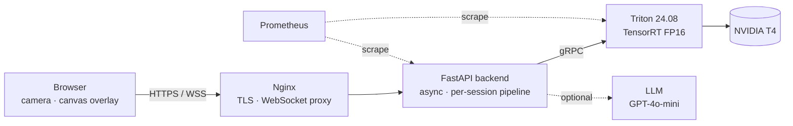
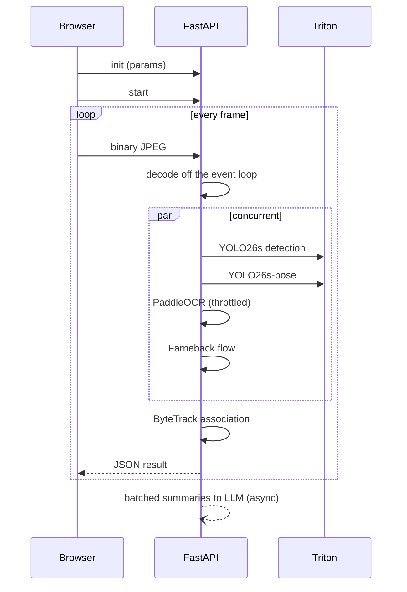
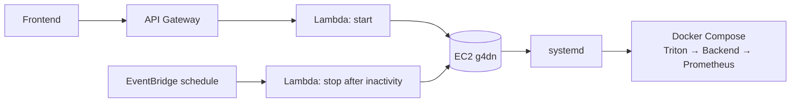

<div align="center">

# Real-Time Multimodal Computer Vision System

Object detection, tracking, pose estimation, OCR, optical flow and LLM scene narration
over a single WebSocket stream, served with **NVIDIA Triton** and **TensorRT FP16**.

[](LICENSE)
[](backend/Dockerfile)
[](backend/app/main.py)
[](triton/model_repository)
[](#models)
[](docker-compose.yml)
[](prometheus/prometheus.yml)

<a href="https://github.com/vitaliipavlov1/Multimodal-CV-System/releases/download/v1.0.0/Demo.mp4">
  
</a>

[**Live demo**](https://vitaliipavlov.website) ·
[**Full video (MP4)**](https://github.com/vitaliipavlov1/Multimodal-CV-System/releases/download/v1.0.0/Demo.mp4) ·
[**Architecture**](ARCHITECTURE.md) ·
[**API**](#api)

<sub>The GPU instance starts on demand; cold start is about 30–60 s.</sub>

</div>

---

## Contents

- [Features](#features)
- [Architecture](#architecture)
- [Inference pipeline](#inference-pipeline)
- [Models](#models)
- [Stack](#stack)
- [Project structure](#project-structure)
- [Deployment](#deployment)
- [API](#api)
- [Observability](#observability)
- [Instance lifecycle](#instance-lifecycle)
- [License](#license)

---

## Features

| Capability | Implementation |
|---|---|
| Object detection | YOLO26s, TensorRT FP16, NMS-free end-to-end output |
| Multi-object tracking | ByteTrack, two-pass IoU association, `lapjv` assignment, per-stream registry with TTL pruning |
| Pose estimation | YOLO26s-pose, TensorRT FP16, 17 keypoints per person |
| Text recognition | PaddleOCR on CPU, throttled and event-driven |
| Motion | Farneback dense optical flow |
| Scene narration | LangChain + GPT-4o-mini, optional, runs in a background task per session |
| Transport | Binary JPEG frames in, JSON results out over one WebSocket |
| Monitoring | Prometheus metrics for the backend and Triton |

Rendering and inference are decoupled: the browser renders at 30+ FPS while inference results arrive at the rate the GPU sustains.

---

## Architecture



Component details, the AWS start/stop flow and design decisions are in [ARCHITECTURE.md](ARCHITECTURE.md).

---

## Inference pipeline



1. A binary JPEG arrives over the WebSocket.
2. The frame is decoded in a `ThreadPoolExecutor`, off the event loop.
3. Enabled modules run concurrently through `asyncio.gather`.
4. Detections go through ByteTrack to obtain stable `track_id` values.
5. Results are streamed back as JSON.
6. Aggregated observations are sent to the LLM asynchronously and returned as narration.

A bounded per-session frame queue (size 2) keeps the newest frame; older frames are dropped when inference is behind.

---

## Models

### YOLO26s detection

| | |
|---|---|
| Input | FP16 `[1, 3, 640, 640]` |
| Output | FP32 `[1, 300, 6]` — `[x1, y1, x2, y2, conf, cls]` |
| Post-processing | none, NMS-free |
| Build | `trtexec --fp16 --inputIOFormats=fp16:chw` |

### YOLO26s pose

| | |
|---|---|
| Input | FP16 `[1, 3, 640, 640]` |
| Output | FP32 `[1, 300, 57]` — box + 17 keypoints × 3 |
| Classes | single class (person) |

### ByteTrack

- Two-pass IoU association: high-confidence detections against all tracks, then low-confidence detections against unmatched tracks.
- Optimal assignment via `lapjv` (`lapx`).
- Per-stream tracker registry with TTL pruning.

---

## Stack

| Layer | Technology |
|---|---|
| Detection | YOLO26s, TensorRT FP16 |
| Tracking | ByteTrack, `lapjv` |
| Pose | YOLO26s-pose, TensorRT FP16 |
| OCR | PaddleOCR (CPU) |
| Motion | Farneback optical flow (OpenCV) |
| Inference server | Triton 24.08, TensorRT 10.3 |
| API | FastAPI, async WebSocket |
| LLM | LangChain, GPT-4o-mini |
| Metrics | Prometheus |
| Proxy | Nginx, HTTPS + WebSocket |
| Infrastructure | AWS EC2 g4dn.xlarge (NVIDIA T4, 16 GB) |

---

## Project structure

```
.
├── backend/
│   ├── Dockerfile
│   ├── requirements.txt
│   └── app/
│       ├── main.py                  # FastAPI app, WebSocket handler
│       ├── inference/
│       │   ├── yolo.py              # detection + ByteTrack
│       │   ├── yolo_pose.py         # pose estimation
│       │   ├── triton_client.py     # shared async gRPC client
│       │   ├── motion.py            # Farneback optical flow
│       │   └── ocr.py               # PaddleOCR (throttled)
│       ├── pipeline/
│       │   └── multimodal.py        # concurrent inference pipeline
│       └── monitoring/
│           └── metrics.py           # Prometheus metrics
├── triton/
│   └── model_repository/
│       ├── yolo/                    # detection (TensorRT FP16)
│       └── yolo_pose/               # pose (TensorRT FP16)
├── nginx/                           # HTTPS + WebSocket proxy reference config
├── prometheus/                      # scrape config
├── infra/systemd/                   # boot-time Compose unit
├── docs/media/                      # demo preview
├── ARCHITECTURE.md
└── docker-compose.yml
```

---

## Deployment

### Requirements

- NVIDIA GPU host (reference: AWS EC2 g4dn.xlarge, T4 16 GB)
- Ubuntu 22.04, NVIDIA driver 580+
- Docker and NVIDIA Container Toolkit

### Build TensorRT engines

```bash
# detection
docker run --rm --gpus all -v ~/project:/workspace \
  nvcr.io/nvidia/tensorrt:24.08-py3 trtexec \
  --onnx=/workspace/onnx/yolo26s.onnx \
  --saveEngine=/workspace/triton/model_repository/yolo/1/model.plan \
  --fp16 --inputIOFormats=fp16:chw --outputIOFormats=fp32:chw

# pose
docker run --rm --gpus all -v ~/project:/workspace \
  nvcr.io/nvidia/tensorrt:24.08-py3 trtexec \
  --onnx=/workspace/onnx/yolo26s-pose.onnx \
  --saveEngine=/workspace/triton/model_repository/yolo_pose/1/model.plan \
  --fp16 --inputIOFormats=fp16:chw --outputIOFormats=fp32:chw
```

### Start the stack

```bash
cp .env.example .env   # set OPENAI_API_KEY
docker compose up -d
```

### Autostart with systemd

```bash
sudo cp infra/systemd/inference-compose.service.example \
  /etc/systemd/system/inference-compose.service
sudo systemctl daemon-reload
sudo systemctl enable inference-compose
```

### Environment variables

| Variable | Description |
|---|---|
| `OPENAI_API_KEY` | Required for LLM narration (`use_langchain`) |

`.env` is gitignored; `.env.example` is the template.

---

## API

### WebSocket `/ws/inference`

Connect → send `init` → send `start` → stream binary JPEG frames. Send `stop` to end inference.

```jsonc
// init
{
  "type": "init",
  "params": {
    "use_yolo": true,
    "use_yolo_pose": true,
    "use_ocr": false,
    "use_motion": false,
    "use_langchain": false
  }
}
```

```jsonc
// per-frame result
{
  "type": "inference",
  "data": {
    "yolo": {
      "boxes":     [[x1, y1, x2, y2], ...],
      "classes":   [0, ...],
      "scores":    [0.95, ...],
      "track_ids": [1, 2, ...]
    },
    "pose": {
      "boxes":     [...],
      "keypoints": [[[x, y, conf], ...], ...]
    },
    "flow": { "fx": [...], "fy": [...], "step": 16 },
    "fps": 28.4
  }
}
```

### HTTP

| Endpoint | Description |
|---|---|
| `GET /health` | Health check |
| `GET /metrics` | Prometheus metrics |

---

## Observability

Prometheus scrapes the backend (`:8000`) and Triton (`:8002`) every 5 s.

| Metric | Type | Meaning |
|---|---|---|
| `inference_requests_total{status}` | counter | Inference requests by status |
| `inference_active_sessions` | gauge | Active sessions |
| `inference_duration_seconds` | histogram | Session duration |
| `gpu_semaphore_in_use` | gauge | Sessions holding the GPU semaphore |
| `pipeline_fps` | gauge | Rolling pipeline FPS |
| `session_frames_total{session_id}` | counter | Frames processed per session |

---

## Instance lifecycle

The GPU instance is started and stopped on demand.



---

## License

Licensed under the [Apache License 2.0](LICENSE).
